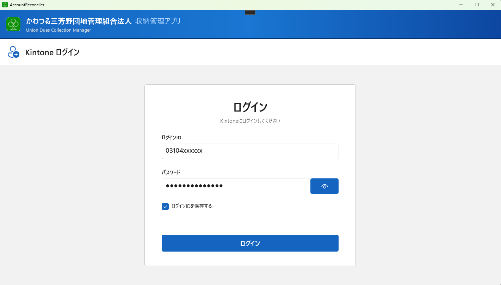
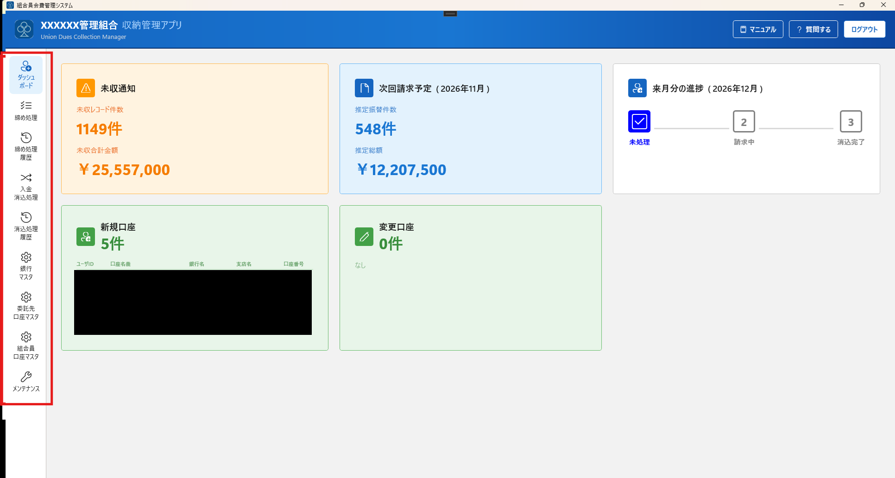
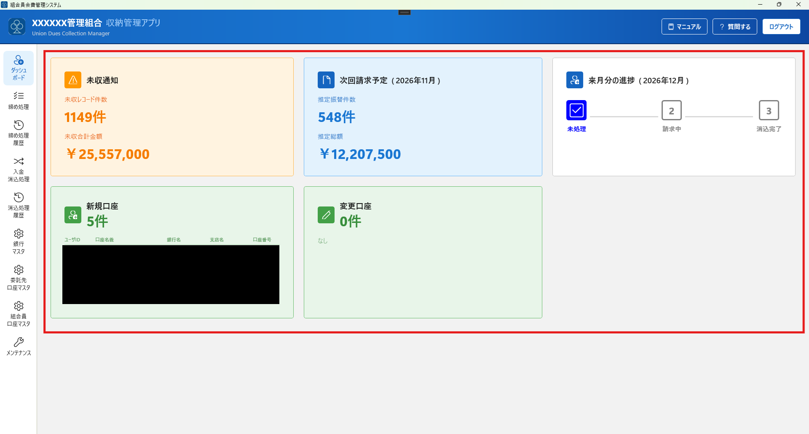
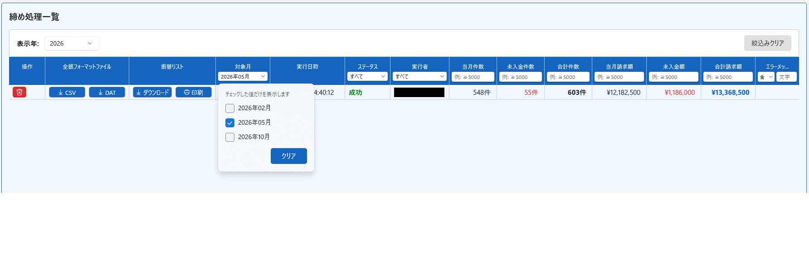
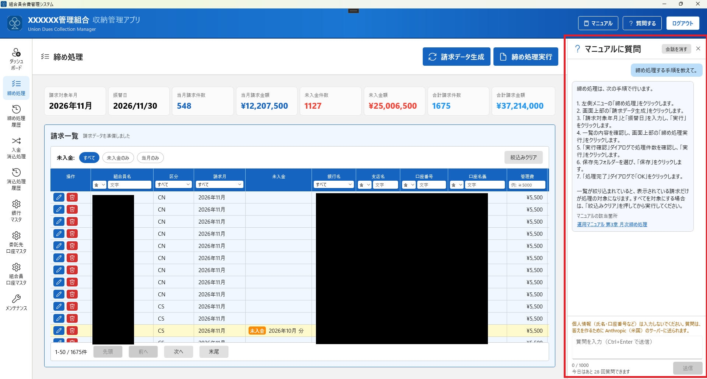

# 第1章 業務概要・基本操作

> - Kintoneとは・.NETとは → **[前提知識](../共通/00_prerequisites.md)**
> - システムの構成・データフロー → **[システム概要](../共通/01_system_overview.md)**

---

## 1-1. このシステムでできること

| 機能 | 内容 |
|------|------|
| **月次締め処理** | 組合員の管理費・修繕積立費・駐車場代を計算し、全銀フォーマットのファイルを生成します |
| **入金消込処理** | 銀行の振替結果CSVを読み込み、入金済み・未入金の状態をKintoneに反映します |
| **マスタ管理** | 組合員の口座情報、銀行・支店、委託先口座を管理します |
| **バックアップ** | データベースのバックアップ・リストアを行います（PC移行時に使用） |
| **操作方法の質問** | 操作方法を操作マニュアルに質問できます（「質問する」ボタン） |

---

## 1-2. 月次業務フロー

```
毎月の業務スケジュール（例）

振替日の5〜7日前
  └→ [締め処理] 請求データ生成・全銀ファイル作成
  └→ 全銀ファイルを銀行へ提出

振替日の翌日〜数日後（銀行から結果ファイル受領後）
  └→ [入金消込] 振替結果CSVを読み込み・消込実行
  └→ 未入金者への対応（別途）
```

---

## 1-3. 画面一覧

### メイン画面

| 画面名 | 用途 |
|--------|------|
| **ダッシュボード** | 未収通知・次回請求予定・来月分の進捗・新規口座・変更口座の確認 |
| **締め処理** | 月次請求データの生成・全銀ファイルの作成・実行 |
| **締め処理履歴** | 過去の締め処理ログ・全銀ファイル・振替リストのダウンロード |
| **入金消込処理** | 振替結果CSVの読込・消込実行 |
| **消込処理履歴** | 過去の消込処理ログの確認・未入金者の請求書のダウンロード・印刷 |

### マスタ管理画面

| 画面名 | 用途 |
|--------|------|
| **銀行マスタ** | 銀行コード・銀行名、支店コード・支店名の管理 |
| **委託先口座マスタ** | 振替元となる口座（委託先）の管理 |
| **組合員口座マスタ** | 組合員の銀行口座情報の管理 |

### その他

| 画面名 | 用途 |
|--------|------|
| **メンテナンス** | バックアップ・リストア、文字サイズ、組織名・電話番号、全銀ファイルのコード区分、Kintoneドメインの設定（APIトークンの取り込みなどシステム管理者向けの設定も含む） |
| **マニュアル**（画面上部のボタン） | この操作マニュアルのサイトをブラウザーで開く |
| **質問する**（画面上部のボタン） | 操作方法を操作マニュアルに質問するチャット欄を開く（→ [1-8. 操作方法を質問する](#1-8-操作方法を質問する)） |

> 以前の「設定」画面はサイドメニューからなくなりました。Kintoneドメインはメンテナンス画面で設定します（→ [6-5](06_maintenance.md#6-5-kintoneドメインの設定)）。

---

## 1-4. ログイン手順

システムを起動すると、最初にログイン画面が表示されます。



1. **ログインID** を入力します（KintoneのログインID）

2. **パスワード** を入力します

3. **「ログイン」** ボタンをクリックします

> Kintoneドメインが設定されていない場合は、ログイン画面の前に **「Kintone接続設定」** 画面が表示されます。ドメインを入力して **「保存」** をクリックしてください。設定後のドメインの変更はメンテナンス画面で行います（→ [6-5. Kintoneドメインの設定](06_maintenance.md#6-5-kintoneドメインの設定)）。

> **ログインIDを保存する場合**
> 「ログインIDを保存する」チェックボックスをオンにすると、次回起動時にIDが自動入力されます。
> パスワードは保存されません。

> **ログインの省略について**
> 前回のログインから **24時間以内** にアプリを起動した場合、ログイン画面はスキップされてメイン画面が直接表示されます。
> 24時間を過ぎた場合、または手動でログアウトした場合は、再度ログイン画面が表示されます。

---

## 1-5. 画面の移動方法

画面左側のナビゲーションメニューから各画面に移動できます。



- メニューのアイコンまたはラベルをクリックして切り替えます
- 現在の画面はメニュー上でハイライト表示されます
- メニューの項目は上から順に「ダッシュボード」「締め処理」「締め処理履歴」「入金消込処理」「消込処理履歴」「銀行マスタ」「委託先口座マスタ」「組合員口座マスタ」「メンテナンス」です
- 画面上部（ヘッダー）の右側に **「マニュアル」** ボタン、**「質問する」** ボタン、**「ログアウト」** ボタンがあります
- **「マニュアル」** ボタンをクリックすると、この操作マニュアルのサイトがブラウザーで開きます

---

## 1-6. ダッシュボードの見方

ログイン後に表示されるダッシュボードには、以下の情報が表示されます。

| カード | 内容 |
|--------|------|
| **未収通知** | 未収レコード件数と未収合計金額 |
| **次回請求予定** | 次回の請求の推定振替件数と推定総額 |
| **来月分の進捗** | 来月分の請求の件数を「未処理」「請求中」「消込完了」に分けて表示 |
| **新規口座** | 状態が「新規」の組合員口座の一覧（ユーザID・口座名義・銀行名・支店名・口座番号） |
| **変更口座** | 状態が「変更」の組合員口座の一覧 |



---

## 1-7. 一覧の絞り込み

締め処理・入金消込処理・各マスタ・各履歴の一覧は、列ごとに絞り込めます。
一覧の列見出しの下に、列ごとの絞り込み欄があります。入力するとすぐに一覧が絞り込まれます（実行ボタンはありません）。

| 列の種類 | 絞り込み方 |
|---------|-----------|
| 文字の列（組合員名・口座番号・口座名義など） | 入力欄に文字を入力します。入力欄の左のボタンで一致のしかたを切り替えられます（「含」部分一致・「前」前方一致・「後」後方一致・「＝」完全一致） |
| 数値の列（金額・件数など） | 数値を入力します。先頭に ＝ ≠ ＞ ≧ ＜ ≦ を付けられます（例：`≧5000`）。記号がなければ等しいものを表示します |
| 選択肢の列（銀行名・状態・振替結果など） | ボタンをクリックするとチェックボックスの一覧が開きます。チェックした値だけを表示します（複数選択可）。一覧の「クリア」で選択を外します |

- 複数の列に条件を入れると、すべての条件にあてはまる行だけが表示されます
- 一覧の上の **「絞込みクリア」** ボタンで、すべての条件を消します
- マスタ画面では、一覧の上に **「新規追加」** ボタンもあります



---

## 1-8. 操作方法を質問する

画面上部の **「質問する」** ボタンをクリックすると、画面の右側にチャット欄（「マニュアルに質問」）が開きます。アプリの操作方法を質問すると、この操作マニュアルをもとに答えが表示されます。

1. 画面上部の **「質問する」** ボタンをクリックします
2. 下の入力欄に質問を入力します（例：「締め処理のやり方を教えてください」「入金消込でエラーが出たときは？」）
3. **「送信」** をクリックします（**Ctrl+Enter** でも送信できます）
4. 10秒ほどで答えが表示されます。答えの下の **「マニュアルの該当箇所」** のリンクから、マニュアルの該当ページをブラウザーで開けます



| 操作 | 内容 |
|------|------|
| 会話を消す | それまでの会話を消して、新しく質問を始めます |
| 閉じる（×） | チャット欄を閉じます。閉じても会話は残ります（ログアウトすると消えます） |

> **個人情報（氏名・口座番号など）は入力しないでください。**
> 質問は、答えを作るために Anthropic（米国）のサーバーに送られます。

> **注意事項**
> - 画面に出ている組合員や口座などのデータは、質問機能からは見えません。「〇〇さんの入金は確認できていますか」のようなデータについての質問には答えられません
> - 答えが合っているかは、「マニュアルの該当箇所」のリンクでも確かめてください
> - 1日に質問できる回数には上限があります（PCごとの上限と、全体の上限）。残りの回数は「今日はあと N 回質問できます」と表示されます。上限は日本時間の0時に戻ります。上限に達した場合は、翌日にお試しいただくか、マニュアルのサイトをご覧ください
> - 「このPCには質問機能の設定がありません」と表示される場合は、質問機能の設定がされていません。システム管理者に連絡してください（→ [システム管理マニュアル 第3章](../システム管理マニュアル/03_kintone_config.md)）。それまではチャット欄の「操作マニュアルのサイトを開く」からマニュアルをご覧ください

---

[← 目次へ](index.md) ｜ [次章：初期設定 →](02_initial_setup.md)
