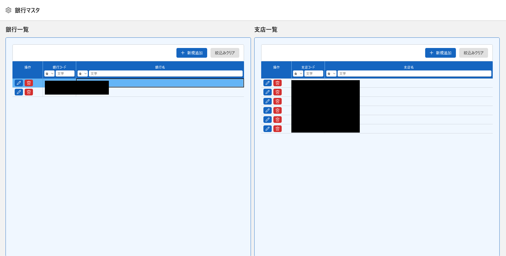
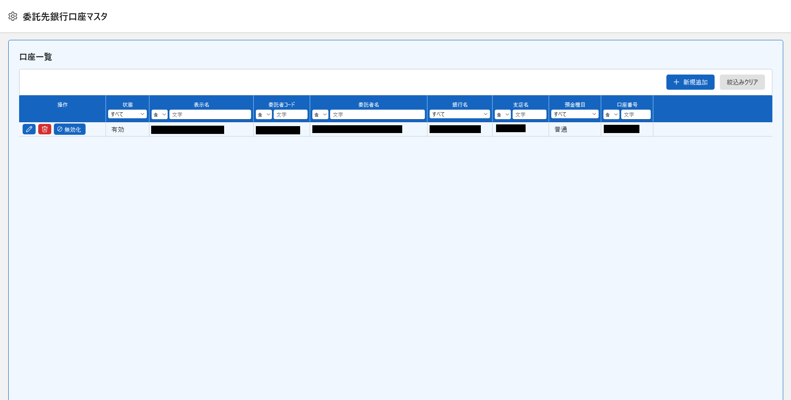
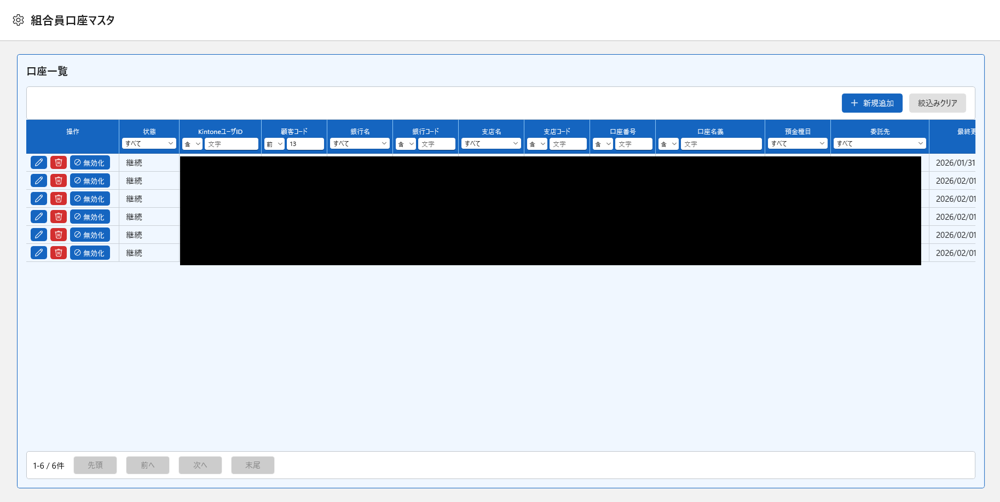
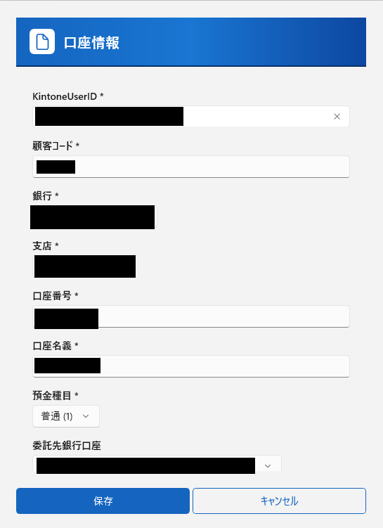

# 第2章 初期設定

システムを初めて使用する際、または環境を新しくセットアップする際の手順です。

---

## 初期設定チェックリスト

以下の順番で設定を進めてください。

- [ ] 2-1. 銀行マスタの登録
- [ ] 2-2. 委託先口座の登録
- [ ] 2-3. 組合員口座の登録

---

## 2-1. 銀行マスタの登録

全銀ファイルの銀行名・支店名を正しく出力するため、使用する銀行・支店を登録します。

### 銀行を追加する

1. 左側メニューから **「銀行マスタ」** を開きます
2. 左列「銀行一覧」の **「新規追加」** ボタンをクリックします
3. 以下を入力して **「登録」** をクリックします

| 項目 | 内容 |
|------|------|
| 銀行コード | 4桁の銀行コード（例：`0001`） |
| 銀行名 | 半角カナで入力（例：`ミツビシUFJｷﾞﾝｺｳ`） |

### 支店を追加する

1. 銀行一覧から対象の銀行を選択します（右列に支店一覧が表示されます）
2. 右列「支店一覧」の **「新規追加」** ボタンをクリックします
3. 以下を入力して **「登録」** をクリックします

| 項目 | 内容 |
|------|------|
| 支店コード | 3桁の支店コード（例：`001`） |
| 支店名 | 半角カナで入力（例：`ﾎﾝﾃﾞﾝ`） |

> **銀行名・支店名は半角カナで入力してください。**
> 全銀フォーマットの規格に合わせるため、半角カナが必要です。

---

## 2-2. 委託先口座の登録

> ※現状、複数委託先口座には対応していません。

振替の委託元となる口座情報を登録します。

1. 左側メニューから **「委託先口座マスタ」** を開きます
2. **「新規追加」** ボタンをクリックします
3. 「委託先銀行口座情報」ダイアログで以下を入力します（* は必須）

| 項目 | 内容 |
|------|------|
| 表示名 * | 画面上での識別名（例：「メイン口座」） |
| 委託者コード * | 全銀ヘッダに使用する委託者コード（10桁以内の数字） |
| 委託者名 * | 全銀ヘッダに使用する委託者名（半角カナ、40文字以内） |
| 取引銀行 * | 振替元の銀行を一覧から選択（銀行マスタに登録した銀行） |
| 取引支店 * | 振替元の支店を一覧から選択 |
| 預金種目 * | 普通 (1)・当座 (2)・貯蓄 (4) から選択 |
| 口座番号 * | 1〜7桁の口座番号 |
| 銀行サイトのURL | 全銀ファイルのアップロードと振替結果のダウンロードを行う、委託先銀行のサイトのURL（任意。`https://` から始まるもの） |
| ステータス | 有効・無効 |

4. **「保存」** をクリックします
5. 登録後、一覧の「状態」が **「有効」** になっていることを確認します（無効の場合は、行の **「有効化」** ボタンで切り替え）

> **銀行サイトのURLについて**
> 登録しておくと、委託先口座マスタの一覧の **「サイトを開く」** ボタン、締め処理の完了ダイアログ、振替結果CSVファイル読込ダイアログから、委託先銀行のサイトを既定のブラウザーで開けます。
> IDやパスワードを含むURLは登録できません。

---

## 2-3. 組合員口座の登録

組合員ごとの振替先口座情報を登録します。

1. 左側メニューから **「組合員口座マスタ」** を開きます
2. **「新規追加」** ボタンをクリックします
3. 「口座情報」ダイアログで以下を入力します（* は必須）

| 項目 | 内容 |
|------|------|
| KintoneUserID * | KintoneのユーザーID（組合員と紐付けるため必須） |
| 顧客コード * | 棟番号＋部屋番号の5桁の数字（例：`10101`）。全銀ファイルの顧客番号に使います |
| 銀行 * | 銀行を一覧から選択（銀行マスタに登録した銀行） |
| 支店 * | 支店を一覧から選択 |
| 口座番号 * | 1〜7桁の口座番号 |
| 口座名義 * | 半角カタカナ・英数字・記号（スペース、ハイフン、スラッシュ）で入力 |
| 預金種目 * | 普通 (1)・当座 (2)・貯蓄 (4) から選択 |
| 委託先銀行口座 | 2-2で登録した委託先口座を選択（任意） |

4. **「保存」** をクリックします

> **口座情報はセキュリティ保護のため暗号化して保存されます。**
> 登録後は画面上でも口座番号の一部がマスクされて表示されます。

> **顧客コードが未入力の口座があると、締め処理の「請求データ生成」でエラーになります。**
> 「以下の組合員口座に顧客コードが設定されていません」と表示された場合は、表示された口座の顧客コードを入力してください。

### 口座状態について

新規登録した組合員口座は **「新規」** 状態になります。

| 状態 | 説明 |
|------|------|
| 新規 | 初回登録、またはKintone初回振替前の状態 |
| 継続 | 振替成功済みの通常状態 |
| 変更 | 口座情報を変更した状態（次回振替で反映） |
| 無効 | 使用停止した口座 |

初回の振替成功後に「新規」→「継続」へ自動的に遷移します。

---

## 初期設定完了後の確認

以下をダッシュボードや各マスタ画面で確認します。

- [ ] ダッシュボードが正常に表示されている
- [ ] 銀行マスタに使用する銀行・支店が登録されている
- [ ] 委託先口座が少なくとも1件「有効」状態で登録されている
- [ ] 組合員口座に顧客コードが入力されている
- [ ] 組合員口座が登録されている（Kintoneの組合員数と一致しているか確認）

---

[← 前章：システム概要](01_overview.md) ｜ [次章：月次締め処理 →](03_monthly_billing.md)
