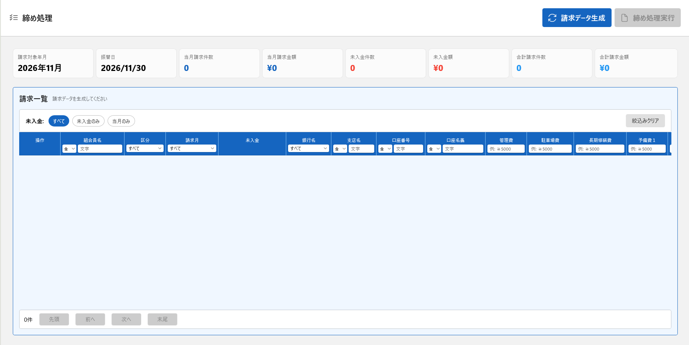
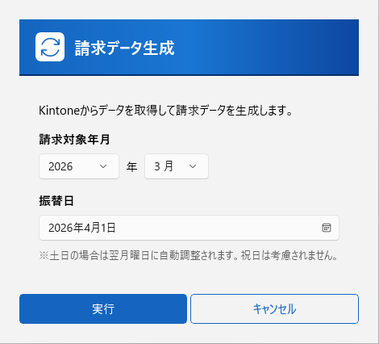
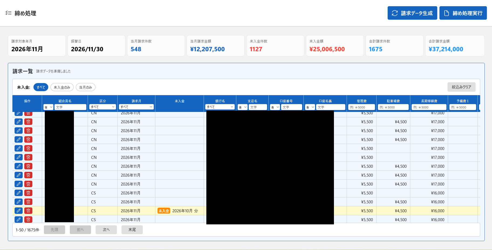
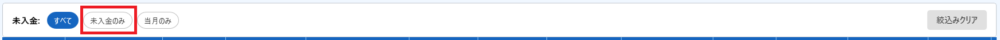
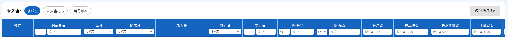
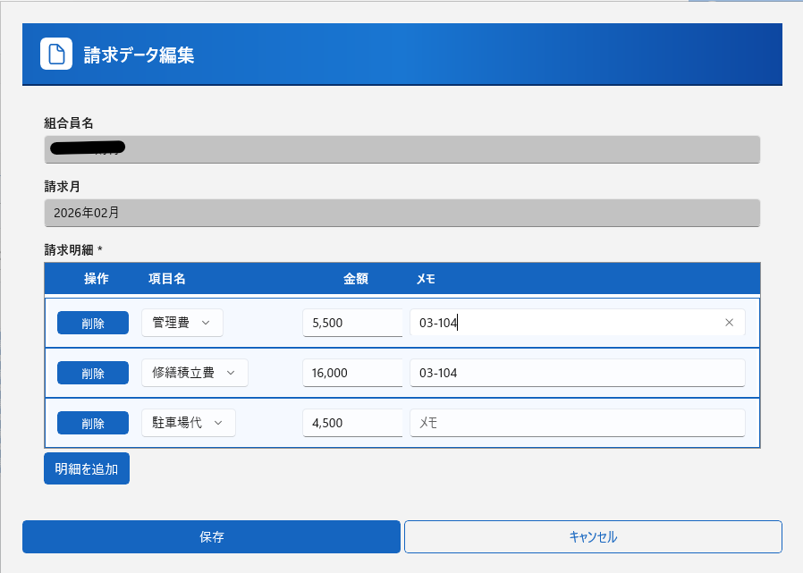
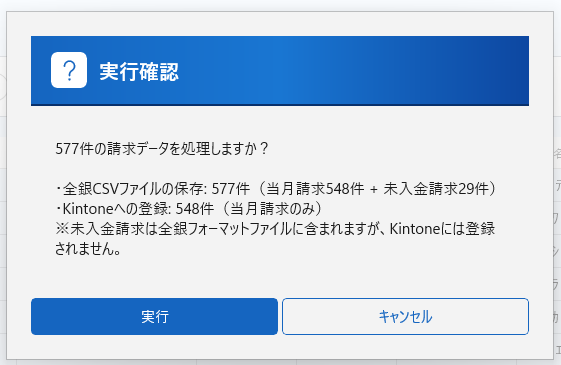
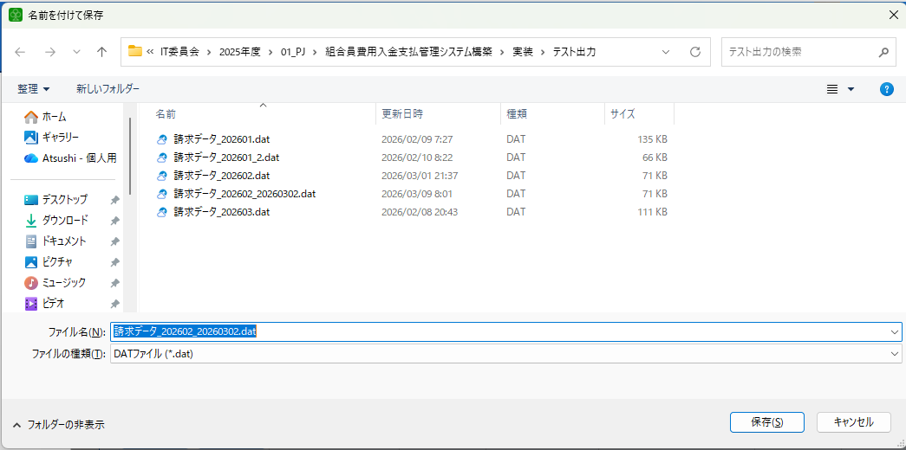
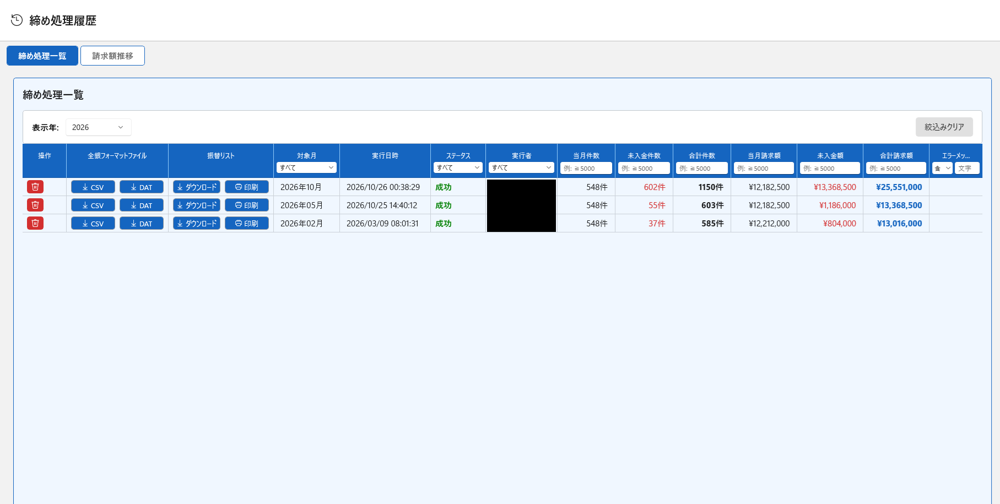

# 第3章 月次締め処理

毎月の組合費請求データを生成し、銀行への振替依頼ファイル（全銀ファイル）を作成します。

**実施タイミング：** 振替日の5〜7日前（銀行の締切に合わせて実施）

---

## 締め処理の全体手順

```
1. 締め処理画面を開く
   ↓
2. 「請求データ生成」をクリックし、請求対象年月・振替日を入力
   ↓
3. 生成されたデータを確認・修正
   ↓
4. 「締め処理実行」をクリック
   ↓
5. 全銀ファイルを保存
   ↓
6. ファイルを銀行に提出
```

---

## 3-1. 締め処理画面を開く

左側メニューから **「締め処理」** をクリックします。



---

## 3-2. 請求データを生成する

1. 画面上部の **「請求データ生成」** ボタンをクリックします



2. 請求データ生成ダイアログが表示されるので、以下の項目を入力して **「実行」** ボタンをクリックします。

| 項目 | 内容 |
|--------|------|
| **請求対象年月** | 今回の請求対象となる年月（年・月を選択） |
| **振替日** | 銀行への振替指定日。土日の場合は翌月曜日に自動調整されます（祝日は考慮されません） |

> すでに作成済みの対象月の請求データがある場合は、「すでに作成済みの対象月の請求データがありますが、それも含めますか？」と確認されます。「はい」「いいえ」で選択してください。

3. 処理中は画面にローディング表示が出ます（Kintoneからデータを取得して計算中）
4. 処理が完了すると、統計カードと請求一覧が更新されます

> **請求データ生成がエラーで止まる場合**
> - 「以下の組合員口座に無効な委託先が設定されています」：委託先口座マスタで委託先を有効にするか、組合員口座の委託先を変更してください
> - 「以下の組合員口座に顧客コードが設定されていません」：組合員口座マスタで、表示された口座の顧客コード（棟番号＋部屋番号の5桁）を入力してください



### 統計カードの見方

| カード | 内容 |
|--------|------|
| **当月請求件数** | 今月分の請求対象件数 |
| **当月請求金額** | 今月分の請求合計金額 |
| **未入金件数** | 過去月から繰り越された未入金件数 |
| **未入金額** | 過去月から繰り越された未入金合計額 |
| **合計請求件数** | 当月 + 未入金の合計件数（全銀ファイルに含まれる件数） |
| **合計請求金額** | 当月 + 未入金の合計金額 |

> **未入金件数・未入金額が表示されている場合**
> 前月以前に入金されなかった分が今回の振替に含まれています。
> 一覧の上の「未入金:」で「未入金のみ」を選ぶと該当者を確認できます。



---

## 3-3. 請求データを確認・修正する

### 一覧の確認

生成された請求一覧に以下が表示されます。

| 列名 | 内容 |
|------|------|
| 組合員名 | 請求対象の組合員名 |
| 区分 | 所有物件の種別 |
| 請求月 | 請求対象月 |
| 未入金 | 前月以前からの繰越の場合、元の請求月が表示される |
| 銀行・支店・口座番号・口座名義 | 振替先の口座情報 |
| 管理費 | 管理費の請求額 |
| 駐車場費 | 駐車場代の請求額 |
| 長期修繕費 | 修繕積立費の請求額 |
| 予備費１〜予備費４ | その他の費用 |
| 当月請求額 | 合計請求金額 |

一覧が長い場合は、一覧の下の「先頭」「前へ」「次へ」「末尾」でページを切り替えます。

### フィルターで絞り込む



一覧の上の **「未入金:」** で、表示する請求を切り替えます。

| 選択肢 | 内容 |
|------|------|
| すべて | すべての請求を表示 |
| 未入金のみ | 前月以前から繰り越された未入金の請求だけを表示 |
| 当月のみ | 当月分の請求だけを表示 |

さらに、一覧の列見出しの下の絞り込み欄で、組合員名・区分・請求月・銀行・支店・口座番号・口座名義・各金額の列ごとに絞り込めます（使い方は → [第1章 1-7. 一覧の絞り込み](01_overview.md#1-7-一覧の絞り込み)）。
**「絞込みクリア」** ですべての条件を消します。

> 締め処理実行では、絞り込んで表示している請求だけが処理の対象になります。すべての請求を処理する場合は、「絞込みクリア」で条件を消してから実行してください。

### 請求明細を変更する

請求明細の追加・変更がある場合は、各行の **「編集」** ボタンから起動する請求データ編集ダイアログから編集することができます。


「明細を追加」で項目を追加することができ、各明細行の「削除」ボタンで削除することができます。
確定する場合は「保存」ボタンをクリックしてください。

今回の請求から外す場合は、各行の **「削除」** ボタンをクリックします。削除確認ダイアログで組合員名・請求月・合計請求額を確認し、**「削除」** をクリックします。



> **Kintoneのデータが誤っている場合は、Kintone側を修正してから「請求データ生成」を再実行してください。**
> システム上の編集は一時的なもので、Kintoneには反映されません。

---

## 3-4. 締め処理を実行する

1. 内容を確認したら、画面上部の **「締め処理実行」** ボタンをクリックします
2. 確認ダイアログ（「実行確認」）が表示されます。処理件数（全銀ファイルに含める件数、Kintoneへ登録する件数）を確認して **「実行」** をクリックします



> 未入金請求（前月以前からの繰越）は全銀ファイルに含まれますが、Kintoneには登録されません。

3. 組合員口座が未登録または無効の請求がある場合は、「口座振替の対象外」ダイアログに対象の組合員が表示されます。これらは全銀ファイルに含まれません（当月分の請求はKintoneに登録されるので、窓口払いなどで別途回収してください）。**「続行」** で処理を続け、**「キャンセル」** で中止します
4. 全銀ファイルの保存ダイアログが表示されます。保存先フォルダを選択して **「保存」** をクリックします（委託先口座が複数ある場合は、委託先ごとに保存ダイアログが表示されます）



5. ファイルの保存後、Kintoneへの請求レコードの登録が行われます（処理中はローディング表示が出ます）
6. 処理が完了すると、「処理完了」ダイアログが表示されます

> **委託先口座が複数ある場合**
> 組合員口座に設定した委託先口座ごとに全銀ファイルが分けて作られ、委託先ごとに保存ダイアログが表示されます。それぞれのファイルを、対応する委託先銀行に提出してください。

> **「実行エラー」で全銀ファイルの項目の不備が表示された場合**
> 表示された内容を、組合員口座マスタ・銀行マスタ・委託先口座マスタで修正してから、もう一度実行してください。
> 「委託先口座が設定されていません（組合員口座の委託先を設定してください）」と表示された場合は、組合員口座マスタで委託先銀行口座が未設定の口座に、委託先を設定してください。

> 保存ダイアログでキャンセルすると、締め処理は中止されます（Kintoneへの登録も行われません）。

### 処理完了ダイアログ

処理完了ダイアログには、Kintoneへの登録件数（新規・更新）と、全銀ファイルの対象外にした件数が表示されます。
「保存した全銀ファイル」欄には、保存したファイルごとに次のボタンが表示されます。

| ボタン | 内容 |
|------|------|
| フォルダーを開く | 全銀ファイルを保存したフォルダーをエクスプローラーで開きます |
| パスをコピー | 全銀ファイルの保存場所（パス）をコピーします |
| （委託先の表示名）のサイトを開く（ホスト名） | 委託先銀行のサイトを既定のブラウザーで開きます。委託先口座マスタに銀行サイトのURLを登録している場合だけ表示されます |

ボタンを押してもダイアログは閉じません。確認が済んだら **「OK」** で閉じます。

### ファイル形式について

全銀ファイルには2種類の形式があります。

| 形式 | 拡張子 | 用途 |
|------|--------|------|
| CSV形式 | `.csv` | 多くの銀行のインターネットバンキングで使用 |
| 固定長形式 | `.dat` | 一部の銀行で必要な形式 |

締め処理実行で保存されるのは、固定長形式（`.dat`）のファイルです。
CSV形式のファイルが必要な場合は、締め処理履歴からダウンロードできます（→ 3-6）。
全銀ファイルのヘッダーのコード区分（JIS・EBCDIC）は、メンテナンス画面で設定します（→ [第6章](06_maintenance.md)）。

### ファイル名の規則

保存ダイアログに表示されるファイル名は以下の形式です：

```
請求データ_YYYYMM_YYYYMMDD.dat  （例：請求データ_202502_20250302.dat）
```
> YYYYMM：請求月、YYYYMMDD：振替指定日。委託先口座が複数ある場合は、末尾に `_委託先の表示名` が付きます

---

## 3-5. ファイルを銀行に提出する

1. 委託先銀行のインターネットバンキングにログインします（処理完了ダイアログの「サイトを開く」ボタンから開けます）
2. 保存した全銀ファイルを、銀行の指定の方法で提出（アップロード）します
3. 委託先口座が複数ある場合は、委託先ごとのファイルを、それぞれの委託先銀行に提出します（ファイル名の末尾の表示名で、どの委託先のファイルかがわかります）

> **ファイルの取り扱いに注意してください。**
> 全銀ファイルには口座番号・口座名義など個人情報が含まれています。
> 提出後は適切に管理（不要になったら削除）してください。

---

## 3-6. 処理結果の確認

締め処理が完了すると、左側メニューの **「締め処理履歴」** から実行履歴を確認できます。

- 実行日時・対象月・ステータス・処理件数・合計金額などが記録されます
- 一覧の上の **「表示年:」** で、表示する年を切り替えます
- 各行の「全銀フォーマットファイル」列の **「CSV」「DAT」** で全銀ファイルを、「振替リスト」列の **「ダウンロード」** で振替リスト（Excel形式）をダウンロードできます。**「印刷」** で振替リストを印刷します
- 各行の **「削除」** で処理履歴を削除します
- 画面下部の「月毎の請求額推移」で、月ごとの請求額の推移を確認できます



---

## よくある確認事項

| 確認内容 | 確認場所 |
|---------|---------|
| 請求件数がKintoneの組合員数と大きく異なる | 組合員口座マスタに全員登録されているか確認 |
| 委託先口座に関するエラーが出る | 委託先口座マスタで「有効」状態を確認 |
| 特定の組合員が一覧に出ない | 組合員口座マスタにその組合員のKintoneIDが登録されているか確認 |
| 顧客コードのエラーが出る | 組合員口座マスタで顧客コード（5桁）が入力されているか確認 |
| 金額が予想と異なる | Kintone上の管理費・修繕積立費・駐車場契約の内容を確認 |

---

[← 前章：初期設定](02_initial_setup.md) ｜ [次章：入金消込処理 →](04_reconciliation.md)
