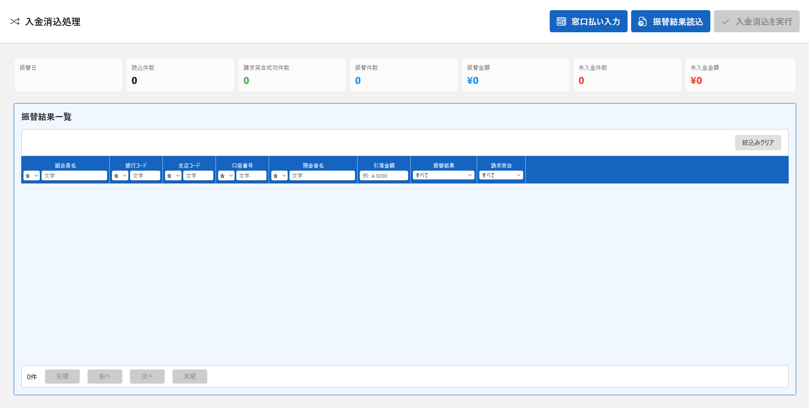
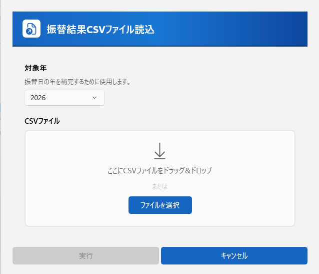
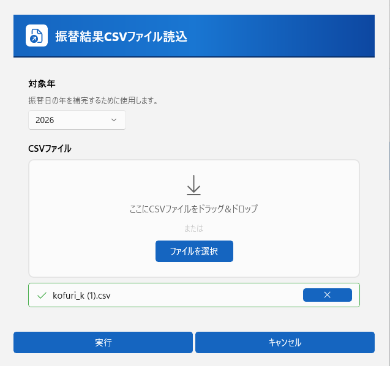
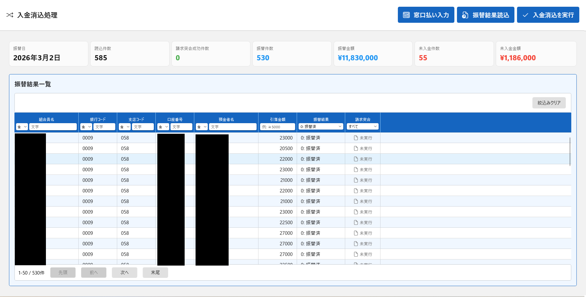
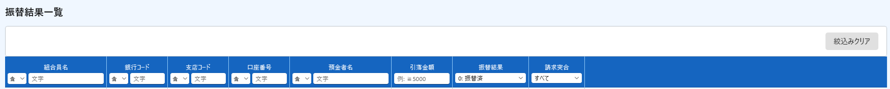
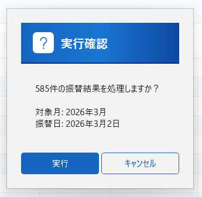
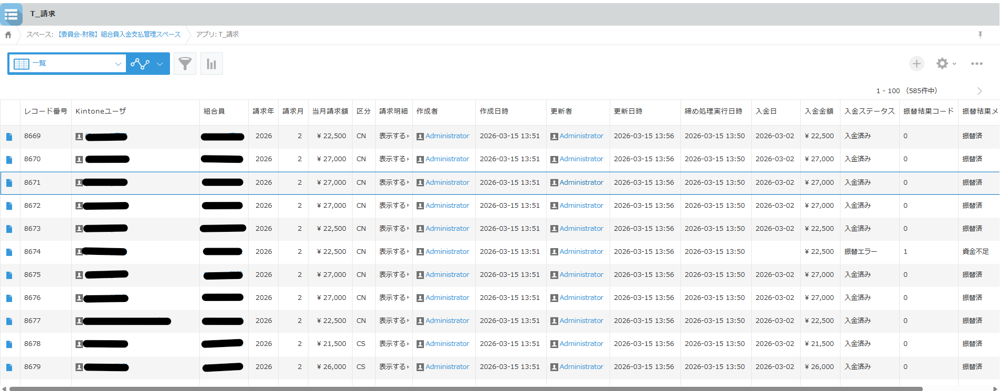
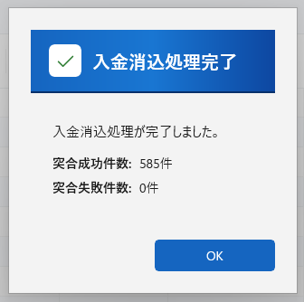
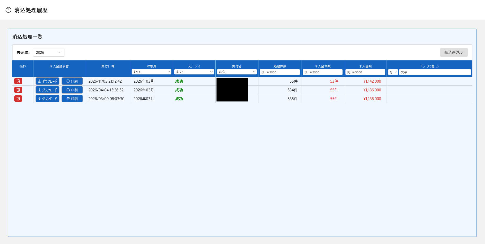

# 第4章 入金消込処理

銀行からの振替結果ファイル（CSV）を取り込み、入金状況をKintoneに反映します。

**実施タイミング：** 振替日の翌日以降、銀行から振替結果CSVを受け取った後

---

## 入金消込の全体手順

```
1. 銀行から振替結果CSVをダウンロード
   ↓
2. 入金消込画面を開く
   ↓
3. 「振替結果読込」でCSVファイルを選択
   ↓
4. 読み込んだデータを確認
   ↓
5. 「入金消込を実行」をクリック
   ↓
6. 実行結果を確認
   ↓
7. 未突合がある場合は手動対応
```

---

## 4-1. 振替結果CSVを準備する

振替依頼を送った銀行のインターネットバンキングにログインし、振替結果ファイル（CSV形式）をダウンロードします。

委託先口座マスタに銀行サイトのURLを登録している場合は、4-3の振替結果CSVファイル読込ダイアログにある「振替結果のダウンロード」欄のボタンから、委託先銀行のサイトを開けます。

ダウンロードしたファイルはわかりやすい場所（デスクトップ等）に保存してください。

---

## 4-2. 入金消込画面を開く

左側メニューから **「入金消込処理」** をクリックします。



---

## 4-3. 振替結果CSVを読み込む

1. 画面上部の **「振替結果読込」** ボタンをクリックします
2. 振替結果CSVファイル読込ダイアログが開くので、以下を設定します

| 項目 | 内容 |
|------|------|
| 振替結果のダウンロード | 「（委託先の表示名）のサイトを開く（ホスト名）」ボタンで、委託先銀行のサイトを既定のブラウザーで開けます。まだ振替結果CSVをダウンロードしていない場合に使います（委託先口座マスタに銀行サイトのURLを登録している場合だけ表示されます） |
| 対象年 | 振替日の年（振替結果CSVの振替日に年が含まれないため、補完に使います） |
| CSVファイル | 銀行からダウンロードした振替結果CSVファイル。「ファイルを選択」で選ぶか、枠の中にドラッグ＆ドロップします |



ファイルを選択すると実行ボタンがクリックできるようになります。



3. **「実行」** をクリックします
4. 読み込みが完了すると、統計カードと一覧が更新されます

> この状態ではまだ入金消込処理は実行されていません。入金消込を実行ボタンから処理実行することでKintoneの請求データが消し込まれます。



---

## 4-4. 読み込んだデータを確認する

### 統計カードの見方

| カード | 内容 |
|--------|------|
| **振替日** | 振替が実行された日付 |
| **読込件数** | CSVに含まれていた振替結果の件数 |
| **請求突合成功件数** | 請求レコードと一致した件数 |
| **振替件数** | 振替成功の件数 |
| **振替金額** | 振替成功の合計金額 |
| **未入金件数** | 振替失敗（エラー）の件数 |
| **未入金金額** | 振替失敗の合計金額 |

### 一覧の確認

読み込んだ振替結果の一覧（振替結果一覧）が表示されます。

| 列名 | 内容 |
|------|------|
| 組合員名 | 突合された組合員名（突合できた場合） |
| 銀行コード・支店コード・口座番号 | 振替先の口座情報 |
| 預金者名 | 口座名義（銀行から返ってきた情報） |
| 引落金額 | 振替金額 |
| 振替結果 | 振替の結果コードとメッセージ |
| 請求突合 | 請求レコードとの突合状態 |

一覧が長い場合は、一覧の下の「先頭」「前へ」「次へ」「末尾」でページを切り替えます。

### 振替結果コードの意味

| コード | 意味 | 対応 |
|--------|------|------|
| **0** | 振替成功 | — |
| **1** | 資金不足 | 口座残高が足りません。組合員に連絡してください |
| **2** | 振替なし | 振替依頼が実行されませんでした |
| **3** | 依頼人都合 | 依頼人（組合員）の申出により振替停止 |
| **4** | 受取人都合 | 受取人（組合）側の事情 |
| **8** | その他 | 銀行に問い合わせてください |
| **9** | 該当なし | 振替データに対応する結果がありません |

### 請求突合の状態

| 状態 | 意味 |
|------|------|
| **未実行** | まだ消込を実行していません |
| **成功** | 請求レコードと突合できました |
| **失敗** | 請求レコードと突合できませんでした |

> **「失敗」が表示される場合**
> 口座番号と金額が一致する請求レコードが見つからなかった場合に表示されます。
> 金額の修正や口座情報の変更が必要な場合があります。

### フィルターで絞り込む

一覧の列見出しの下の絞り込み欄で、組合員名・銀行コード・支店コード・口座番号・預金者名・引落金額・振替結果・請求突合の列ごとに絞り込めます（使い方は → [第1章 1-7. 一覧の絞り込み](01_overview.md#1-7-一覧の絞り込み)）。

| 例 | 操作 |
|------|------|
| 口座名義の一部で探す | 「預金者名」の欄に文字を入力 |
| 振替できなかった行だけを見る | 「振替結果」のボタンで、成功（0）以外の結果をチェック |
| 突合できなかった行だけを見る | 「請求突合」のボタンで「失敗」をチェック |

**「絞込みクリア」** ですべての条件を消します。



---

## 4-5. 入金消込を実行する

1. データを確認したら、画面上部の **「入金消込を実行」** ボタンをクリックします
2. 確認ダイアログが表示されます。件数・金額を確認して **「実行」** をクリックします



3. 処理中はローディング表示が出ます
4. 処理完了後、結果ダイアログが表示されます


処理が完了すると：
- Kintoneの請求レコードに入金日・入金金額・入金状態が反映されます
- 「新規」「変更」状態だった組合員口座は「継続」に遷移します



---

## 4-6. 実行結果を確認する

「入金消込処理完了」ダイアログに突合成功件数・突合失敗件数が表示されます。
突合できなかったレコードがある場合は、「突合できなかったレコード」欄に一覧が表示されます（組合員銀行口座マスタに登録されていないか、請求レコードが見つからなかった口座です）。**「OK」** で閉じます。

処理後の一覧では：
- 突合成功した行：**「成功」** アイコンが表示されます
- 突合失敗した行：**「失敗」** アイコンが表示されます



---

## 4-7. 未突合件数がある場合の対応

一覧の「請求突合」列の絞り込みで「失敗」をチェックし、突合できなかった件を確認します。

### よくある原因と対処

| 原因 | 対処 |
|------|------|
| 口座番号が組合員口座マスタと一致しない | 組合員口座マスタの口座情報を確認・修正 |
| 振替金額と請求金額が一致しない | 締め処理画面で該当組合員の請求内容を確認 |
| 該当する請求レコードがKintoneに存在しない | Kintoneで請求レコードを直接確認 |

手動で対応が必要な場合は、Kintoneの請求レコードを直接編集して対応します。
不明な点はシステム管理者にご連絡ください。

---

## 4-8. 処理履歴の確認

入金消込が完了すると、左側メニューの **「消込処理履歴」** から実行履歴を確認できます。

- 一覧の上の **「表示年:」** で、表示する年を切り替えます
- 各行の「未入金請求書」列の **「ダウンロード」** で、未入金者の請求書をWord形式でダウンロードできます。**「印刷」** で一括印刷します
- 各行の **「削除」** で処理履歴を削除します



---

[← 前章：月次締め処理](03_monthly_billing.md) ｜ [次章：マスタ管理 →](05_master_management.md)
