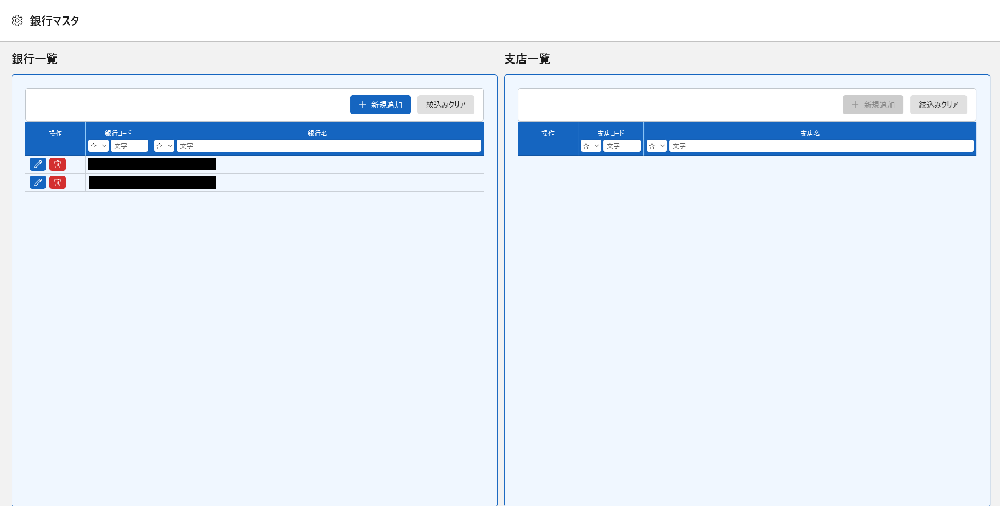
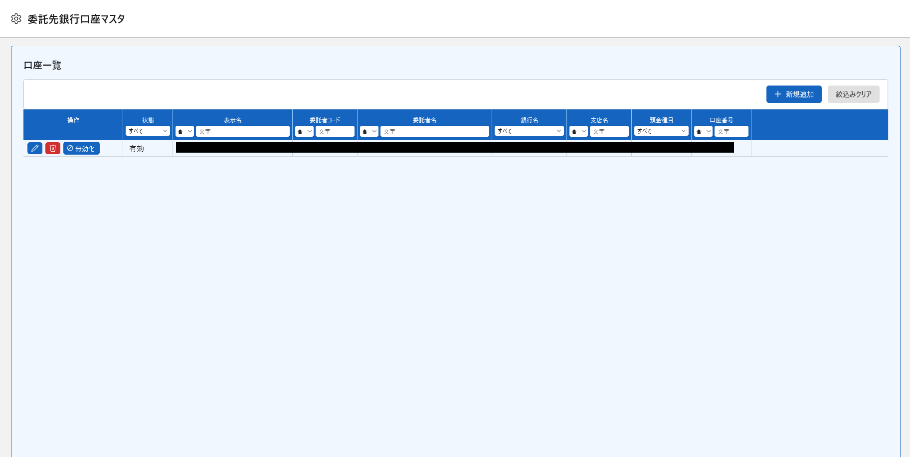
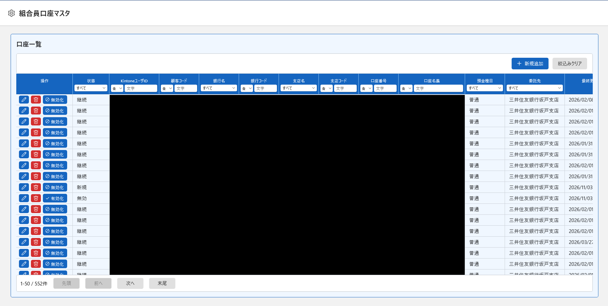

# 第5章 マスタ管理

組合員口座・銀行・委託先口座などのマスタデータを管理します。

---

## 5-1. 銀行マスタ・支店マスタ

### 画面の開き方

左側メニューから **「銀行マスタ」** をクリックします。

画面は左右に分かれており、**左列が銀行一覧**、**右列が支店一覧** です。
銀行一覧で銀行を選択すると、その銀行の支店が右列に表示されます。
どちらの一覧も、列見出しの下の絞り込み欄で銀行コード・銀行名（支店コード・支店名）ごとに絞り込めます（→ [第1章 1-7. 一覧の絞り込み](01_overview.md#1-7-一覧の絞り込み)）。

### 銀行を追加する

1. 銀行一覧の **「新規追加」** ボタンをクリックします
2. 「銀行情報」ダイアログで以下を入力します

   | 項目 | 説明 |
   |------|------|
   | 銀行コード * | 4桁の銀行コード（例：`0001`） |
   | 銀行名 * | 半角カナで入力（例：`ﾐﾂﾋﾞｼUFJｷﾞﾝｺｳ`） |

3. **「保存」** をクリックします

### 銀行を編集・削除する

- 各行の **「編集」** ボタン：銀行コード・銀行名を修正できます
- 各行の **「削除」** ボタン：銀行を削除します（紐付く支店も削除されます）

> 削除確認ダイアログが表示されます。銀行コード・銀行名を確認してから **「削除」** をクリックしてください。

### 支店を追加する

1. 銀行一覧から対象銀行を選択します
2. 支店一覧の **「新規追加」** ボタンをクリックします
3. 「支店情報」ダイアログで以下を入力します

   | 項目 | 説明 |
   |------|------|
   | 支店コード * | 3桁の支店コード（例：`001`） |
   | 支店名 * | 半角カナで入力（例：`ﾎﾝﾃﾞﾝ`） |

4. **「保存」** をクリックします

### 支店を編集・削除する

- 各行の **「編集」** ボタン：支店コード・支店名を修正できます
- 各行の **「削除」** ボタン：支店を削除します

> **全銀ファイルに出力される銀行名・支店名は半角カナである必要があります。**
> 全角や漢字は使用しないでください。

---

## 5-2. 委託先口座マスタ

### 画面の開き方

左側メニューから **「委託先口座マスタ」** をクリックします。

委託先口座は複数登録できます。複数の銀行で口座振替を行う場合は、銀行ごとに登録し、組合員口座マスタで組合員ごとに使用する委託先口座を選びます。
締め処理では、委託先口座ごとに全銀ファイルが分けて作られます（→ [第3章](03_monthly_billing.md)）。

### 委託先口座を追加する

1. **「新規追加」** ボタンをクリックします
2. 「委託先銀行口座情報」ダイアログで以下を入力します（* は必須）

   | 項目 | 説明 |
   |------|------|
   | 表示名 * | システム内での識別名（例：「メイン口座」） |
   | 委託者コード * | 全銀ヘッダに使用するコード（10桁以内の数字） |
   | 委託者名 * | 全銀ヘッダに使用する名称（半角カナ、40文字以内） |
   | 取引銀行 * | 振替元の銀行を一覧から選択 |
   | 取引支店 * | 振替元の支店を一覧から選択 |
   | 預金種目 * | 普通 (1)・当座 (2)・貯蓄 (4) から選択 |
   | 口座番号 * | 1〜7桁の口座番号 |
   | 銀行サイトのURL | 全銀ファイルのアップロードと振替結果のダウンロードを行う、委託先銀行のサイトのURL（任意） |
   | ステータス | 有効・無効 |

3. **「保存」** をクリックします

### 銀行サイトのURL

委託先銀行のインターネットバンキングのURLを登録しておくと、アプリから既定のブラウザーで開けます。

| 開く場所 | 操作 |
|---------|------|
| 委託先口座マスタ | 一覧の行の **「サイトを開く」** ボタン（URLを登録した行だけに表示） |
| 締め処理の処理完了ダイアログ | 「（委託先の表示名）のサイトを開く（ホスト名）」ボタン（→ [第3章](03_monthly_billing.md)） |
| 振替結果CSVファイル読込ダイアログ | 「振替結果のダウンロード」欄のボタン（→ [第4章](04_reconciliation.md)） |

- `https://` から始まるURLだけ登録できます
- IDやパスワードを含むURLは登録できません
- ボタンの文言には開き先のホスト名（例：`www.example-bank.co.jp`）が表示されます。意図したサイトか確かめてから開いてください
- 登録をやめる場合は、編集ダイアログでURLを空欄にして保存します

### 有効・無効を切り替える

一覧の行の **「無効化」** ボタン（有効な行）または **「有効化」** ボタン（無効な行）で状態を切り替えます。編集ダイアログの「ステータス」でも切り替えられます。

- **有効**：締め処理で使用できる状態
- **無効**：締め処理で使用しない状態。無効な委託先が設定された組合員口座があると、請求データ生成でエラーになります

> 使用しない口座は「無効」にしておくことをお勧めします。
> 無効にした委託先口座は、組合員口座の「委託先銀行口座」の一覧に出なくなります。委託先口座を無効にする前に、その委託先を使っている組合員口座の委託先を変更してください。

### 委託先口座を編集・削除する

- 各行の **「編集」** ボタン：内容を修正できます
- 各行の **「削除」** ボタン：削除します（組合員口座に紐付いている場合は削除できません）

一覧は、列見出しの下の絞り込み欄で状態・表示名・委託者コード・委託者名・銀行名・支店名・預金種目・口座番号ごとに絞り込めます（→ [第1章 1-7. 一覧の絞り込み](01_overview.md#1-7-一覧の絞り込み)）。

---

## 5-3. 組合員口座マスタ

### 画面の開き方

左側メニューから **「組合員口座マスタ」** をクリックします。

### 口座状態の意味

組合員口座には以下の4つの状態があります。

| 状態 | 説明 |
|------|------|
| **新規** | 初回登録された状態。次回振替成功時に「継続」へ遷移する。全銀ファイルの「新規コード」が「1」になります |
| **継続** | 通常の活性状態。振替成功済み |
| **変更** | 口座情報（銀行・支店・口座番号・口座名義）を変更した状態。次回振替成功時に「継続」へ遷移する。全銀ファイルの「新規コード」が「2」になります |
| **無効** | 使用停止状態。振替対象から除外されます |

> 全銀フォーマットの「新規コード」は銀行への通知区分です。
> - 新規（コード1）：初めて振替する口座
> - 変更（コード2）：前回から口座情報が変わった口座
> - 継続（コード0）：変更なし

### フィルター・検索

一覧の列見出しの下の絞り込み欄で、列ごとに絞り込めます（使い方は → [第1章 1-7. 一覧の絞り込み](01_overview.md#1-7-一覧の絞り込み)）。

| 列 | 絞り込み方 |
|----------|------|
| 状態 | 新規・継続・変更・無効から選択 |
| KintoneユーザID・顧客コード | 文字で絞り込み |
| 銀行名・支店名 | 一覧から選択 |
| 銀行コード・支店コード・口座番号・口座名義 | 文字で絞り込み |
| 預金種目・委託先 | 一覧から選択 |

**「絞込みクリア」** ですべての条件を消します。一覧が長い場合は、一覧の下の「先頭」「前へ」「次へ」「末尾」でページを切り替えます。

### 組合員口座を新規登録する

1. **「新規追加」** ボタンをクリックします
2. 「口座情報」ダイアログで以下を入力します（* は必須）

   | 項目 | 説明 |
   |------|------|
   | KintoneUserID * | KintoneのユーザーID |
   | 顧客コード * | 棟番号＋部屋番号の5桁の数字（例：`10101`） |
   | 銀行 * | 銀行を一覧から選択 |
   | 支店 * | 支店を一覧から選択 |
   | 口座番号 * | 1〜7桁の口座番号 |
   | 口座名義 * | 半角カタカナ・英数字・記号（スペース、ハイフン、スラッシュ）で入力 |
   | 預金種目 * | 普通 (1)・当座 (2)・貯蓄 (4) から選択 |
   | 委託先銀行口座 | 使用する委託先口座を選択（有効な委託先口座だけが一覧に出ます。口座振替を行う場合は必ず選択） |

3. **「保存」** をクリックします
4. 登録後、状態は「**新規**」になります

### 口座情報を変更する

1. 変更したい行の **「編集」** ボタンをクリックします
2. 変更内容を入力して **「保存」** をクリックします
3. 口座情報（銀行・支店・口座番号・口座名義）を変更すると、状態が **「変更」** に遷移します

> 「変更」状態の口座は、次回の締め処理で全銀ファイルに「変更コード（2）」が付与されます。
> 振替が成功すると自動的に「継続」状態に戻ります。

### 口座を無効化する

退会や口座廃止などで振替が不要になった場合に使用します。

1. 対象行の **「無効化」** ボタンをクリックします
2. 「無効化確認」ダイアログが表示されます。内容を確認して **「無効化」** をクリックします
3. 状態が **「無効」** になり、以降の請求対象から除外されます

### 無効化した口座を再有効化する

1. 対象行の **「有効化」** ボタン（無効な口座の行だけに表示）をクリックします
2. 「口座有効化確認」ダイアログが表示されます。内容を確認して **「有効化」** をクリックします
3. 状態が **「新規」** に戻ります（次回振替成功後に「継続」へ遷移）

### 口座を削除する

口座情報を完全に削除します。通常は「無効化」の使用を推奨します。

1. 対象行の **「削除」** ボタンをクリックします
2. 削除確認ダイアログが表示されます。KintoneUserIDを確認して **「削除」** をクリックします

> **削除すると過去の処理履歴との紐付けも失われます。**
> 退会・廃止の場合は「無効化」を使用し、削除は慎重に行ってください。

---

[← 前章：入金消込処理](04_reconciliation.md) ｜ [次章：バックアップ・メンテナンス →](06_maintenance.md)
